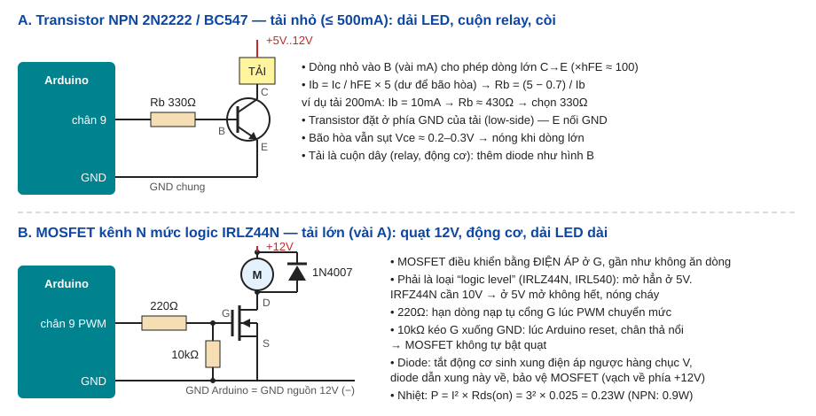

# Bài 29: Transistor / MOSFET — tự thiết kế mạch đóng cắt tải lớn

## Vì sao cần transistor
- Chân Arduino chỉ cho ra **~20mA ở 5V** (tối đa tuyệt đối 40mA, cả chip 200mA). Quạt 12V cần 200mA, dải LED 2A, động cơ vài A → nối thẳng là **cháy chân**.
- Transistor/MOSFET là **công tắc điện tử**: dòng/áp nhỏ từ Arduino điều khiển dòng lớn từ nguồn khác. Module relay (bài 24), L298N (bài 15), ULN2003 (bài 14) bên trong đều là transistor.
- **NPN (BJT):** điều khiển bằng **dòng** vào chân B. Ic ≈ hFE × Ib (hFE ≈ 100). Rẻ, hợp tải nhỏ ≤ 500mA.
- **MOSFET kênh N:** điều khiển bằng **điện áp** ở chân G, gần như không tốn dòng. Khi mở, đoạn D–S chỉ như điện trở vài chục mΩ → ít nóng, hợp tải vài A đến vài chục A.
- **Đặt phía GND (low-side):** tải nối +nguồn, transistor nối tải xuống GND. **GND của nguồn 12V phải nối chung GND Arduino.**

## Code trong bài
- **PWM điều tốc** quạt qua MOSFET, núm vặn chỉnh tốc độ (Wokwi: LED xanh đứng thay quạt).
- **Kick start:** từ đứng yên, chạy 100% trong 300ms cho động cơ thắng ma sát tĩnh, rồi mới về tốc độ chọn.
- **Duty tối thiểu 30%:** dưới mức này động cơ chỉ "ù" mà không quay → tắt hẳn.
- **Ramp:** tăng/giảm duty từng bước → không giật, không làm sụt áp nguồn đột ngột.
- **Bảng tính** in ra Serial lúc khởi động: điện trở base cho NPN, nhiệt tỏa trên MOSFET.

## Phần cứng này dùng ở đâu
- **Mọi mạch công suất:** driver LED, sạc pin, bộ nguồn xung (SMPS), biến tần, xe điện, inverter năng lượng mặt trời — trái tim đều là MOSFET/IGBT đóng cắt hàng chục kHz.
- **Đồ gia dụng:** quạt điều tốc, máy hút bụi, đèn LED dimmer, máy in 3D (bàn nhiệt, đầu đùn dùng MOSFET).
- **Điện thoại/laptop:** MOSFET cắt nguồn từng khối để tiết kiệm pin (load switch).

## Kiến thức của bài trong hệ thống nhúng
- **Tách mạch điều khiển và mạch công suất:** vi điều khiển chỉ ra tín hiệu logic; tầng công suất (driver) chịu dòng áp lớn. Cần cách ly hơn thì dùng opto (bài 24).
- **Trạng thái an toàn khi khởi động:** lúc reset, chân Arduino ở chế độ INPUT (thả nổi) → điện trở kéo xuống 10kΩ giữ MOSFET tắt. Thiết kế thật luôn hỏi "lúc bật nguồn/treo chip thì tải ở trạng thái nào?".
- **Tải cảm (cuộn dây):** tắt dòng đột ngột sinh điện áp ngược (V = L·di/dt) → diode dập (flyback) bắt buộc.
- **Tần số PWM:** Arduino mặc định ~490Hz → động cơ có thể kêu rè rè; sản phẩm thật dùng >20kHz (ngoài tai nghe) bằng cách chỉnh Timer (bài 37).
- **Tính tản nhiệt:** P = I²·Rds(on) (MOSFET) hoặc P = Vce·I (BJT); quá ~1W cần tản nhiệt.

## Dự án thực tế
- **Quạt tản nhiệt tự động:** cảm biến nhiệt độ (bài 11) → tốc độ quạt tỉ lệ nhiệt độ (như quạt CPU).
- **Đèn LED dải 12V dimmer:** 3 MOSFET cho R, G, B → đổi màu bằng remote (bài 20).
- **Bơm tưới cây mini:** MOSFET + bơm 12V + cảm biến độ ẩm đất + RTC hẹn giờ (bài 28).

## Lỗi thường gặp
| Triệu chứng | Nguyên nhân | Cách sửa |
|---|---|---|
| Tải không chạy chút nào | Quên nối GND nguồn 12V với GND Arduino | Nối chung GND |
| MOSFET nóng bỏng tay | Dùng IRFZ44N/IRF540 (cần 10V ở G) với 5V → mở không hết | Dùng loại logic level (IRLZ44N, IRL540N, AO3400) |
| Bật nguồn là quạt tự chạy vài giây | Chân G thả nổi lúc Arduino khởi động | Thêm điện trở 10kΩ từ G xuống GND |
| Arduino reset/treo khi động cơ chạy hoặc tắt | Xung điện áp ngược, sụt áp nguồn chung | Diode flyback, tụ 100µF + 100nF gần động cơ, nguồn riêng cho động cơ |
| Transistor NPN nóng, tải yếu | Rb quá lớn → không bão hòa | Tính lại Ib dư ×5–10, giảm Rb |
| Động cơ kêu rè ở tốc độ thấp | PWM 490Hz nghe được, duty quá thấp | Tăng tần số PWM (bài 37), duty tối thiểu ~30% |
| Lắp ngược chân | Mỗi loại sắp chân khác nhau (BC547: C-B-E, 2N2222: E-B-C) | Luôn tra datasheet mục "pinout" trước khi cắm |

## Bài tập mở rộng
1. **Dễ:** thêm nút bấm: nhấn 1 lần bật/tắt quạt, giữ nguyên tốc độ đã chọn khi bật lại.
2. **Vừa:** quạt tự động theo nhiệt độ DHT (bài 11): <28°C tắt, 28–35°C tốc độ tăng dần, >35°C chạy 100%, có ngưỡng trễ (bài 19).
3. **Khó:** dùng Timer1 đặt PWM 25kHz trên chân 9 (chuẩn quạt PC 4 dây), đọc dây tốc độ (tachometer) của quạt bằng ngắt (bài 26) để hiển thị vòng/phút.

## Từ khóa và datasheet
- **Từ khóa tra cứu:** BJT saturation, hFE, base resistor, logic level MOSFET, Rds(on), Vgs(th), gate charge, low-side switch, high-side switch, flyback diode, gate pull-down, PWM fan control.
- **Datasheet:** **2N2222/BC547** (hFE, Ic max, Vce(sat), pinout), **IRLZ44N** (đồ thị Rds(on) theo Vgs — xem tại Vgs = 4.5V; Vgs(th) chỉ là ngưỡng *bắt đầu* mở chứ không phải mở hẳn), **1N4007** (dòng, áp ngược).

## Câu hỏi phỏng vấn
- **BJT và MOSFET khác nhau thế nào, khi nào dùng loại nào?** Gợi ý: BJT điều khiển bằng dòng, sụt áp Vce cố định; MOSFET điều khiển bằng áp, sụt áp = I·Rds(on) → dòng lớn dùng MOSFET; BJT rẻ, đơn giản cho tải nhỏ.
- **Vgs(th) = 2V, vậy cho 2.5V vào G là đủ không?** Gợi ý: không — Vgs(th) là ngưỡng dòng rất nhỏ (250µA) bắt đầu chảy; phải xem Rds(on) được đảm bảo ở Vgs nào (4.5V với loại logic level).
- **Vì sao low-side dễ hơn high-side với MOSFET kênh N?** Gợi ý: kênh N cần Vg cao hơn Vs; ở high-side Vs ≈ +12V nên cần Vg > 12V (mạch bootstrap/driver) hoặc dùng MOSFET kênh P.
