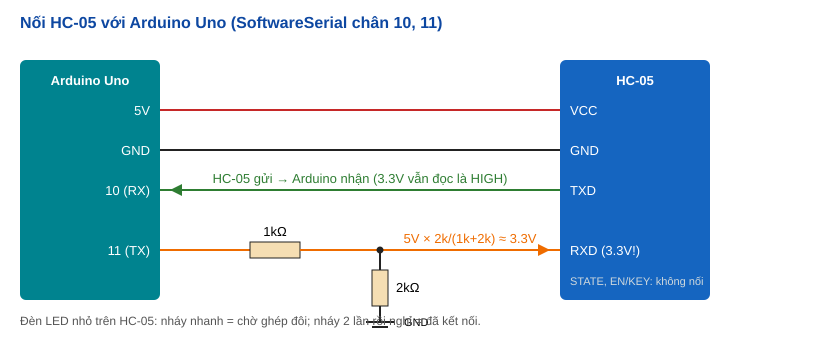

# Bài 30: Bluetooth HC-05 — điều khiển bằng điện thoại

## HC-05 hoạt động thế nào
- Module **Bluetooth cổ điển (SPP – Serial Port Profile)**: với Arduino nó chỉ là **một cổng Serial không dây**. Điện thoại gửi chữ gì, Arduino đọc được đúng chữ đó qua chân TXD.
- **Chân RXD chạy 3.3V** → dùng cầu chia áp 1kΩ/2kΩ từ chân TX của Arduino (5V). Chân TXD của HC-05 ra 3.3V, Arduino vẫn hiểu là HIGH.
- **SoftwareSerial:** Uno chỉ có 1 UART phần cứng (chân 0, 1) đã dùng cho cổng USB. `SoftwareSerial bt(10, 11)` tạo thêm cổng Serial bằng phần mềm. Giới hạn: ổn định tới ~38400 baud, chỉ nghe được 1 cổng mềm một lúc, tắt ngắt khi gửi (có thể ảnh hưởng `millis`, servo).
- **Chế độ AT** (giữ nút trên module khi cấp điện, baud 38400): đổi tên (`AT+NAME`), mã PIN (`AT+PSWD`), baud (`AT+UART`), vai trò master/slave (`AT+ROLE`).
- **HC-06** giống HC-05 nhưng chỉ làm slave. **iPhone không kết nối được** HC-05/06 → dùng module **BLE** (HM-10, hoặc ESP32 có sẵn BLE).

## Code trong bài
- **`Stream*` — con trỏ tới lớp cha:** `Serial` và `SoftwareSerial` đều *là một* `Stream`. Code nhận lệnh viết một lần cho `kenh->...`, đổi `MO_PHONG` là chuyển giữa Wokwi (ô Serial) và HC-05 thật. Đây là **đa hình (polymorphism)** — học kỹ ở bài 31.
- **Hai kiểu lệnh:** chữ đầy đủ (`khach bat`, `quat 60`) cho app dạng gõ phím; 1 ký tự (`K`, `n`, `3`) cho app dạng nút bấm.
- **Luôn phản hồi trạng thái** sau mỗi lệnh → điện thoại biết lệnh đã tới và đã làm.

## Phần cứng này dùng ở đâu
- **Thiết bị nhà thông minh đời đầu, đồ chơi điều khiển bằng app**, xe robot Bluetooth, loa/tai nghe (dùng profile âm thanh A2DP), máy đo đường huyết, cân điện tử truyền số liệu sang app.
- **Cấu hình thiết bị tại hiện trường:** kỹ thuật viên dùng điện thoại đọc lỗi, chỉnh thông số máy công nghiệp không cần cắm cáp.
- **Thay cáp Serial:** nối không dây giữa máy tính và mạch (debug robot đang chạy).

## Kiến thức của bài trong hệ thống nhúng
- **Giao thức tầng ứng dụng:** Bluetooth chỉ chuyển byte; *ý nghĩa* của byte (lệnh gì, trả lời gì) do mình tự thiết kế — giống mọi giao tiếp UART, RS485, MQTT.
- **Mức logic khác nhau (5V ↔ 3.3V):** chia áp, hoặc IC chuyển mức (level shifter) — gặp liên tục khi nối Arduino với ESP32, cảm biến 3.3V, thẻ SD.
- **Trừu tượng hóa phần cứng (HAL):** code xử lý lệnh không phụ thuộc kênh truyền (`Stream*`) → thêm kênh WiFi, RS485 mà không sửa logic.
- **An toàn:** ai ghép đôi được là điều khiển được → đổi mã PIN mặc định, thiết bị thật cần xác thực, mã hóa.

## Dự án thực tế
- **Nhà thông minh mini (bài 34):** điện thoại bật tắt đèn, quạt, đọc nhiệt độ DHT (bài 11), nhận cảnh báo PIR (bài 27).
- **Xe robot Bluetooth:** app có joystick gửi hướng/tốc độ → L298N (bài 15).
- **Khóa cửa Bluetooth:** gửi mật mã từ điện thoại → relay (bài 24).

## Lỗi thường gặp
| Triệu chứng | Nguyên nhân | Cách sửa |
|---|---|---|
| Nhận được ký tự rác | Sai baud (HC-05 dữ liệu 9600, chế độ AT 38400) | `bt.begin(9600)`; kiểm tra lại bằng lệnh AT+UART? |
| Điện thoại gửi, Arduino không nhận | Đấu TXD↔RX ngược | TXD của HC-05 → chân RX của Arduino (10) và ngược lại |
| Nạp code báo lỗi khi HC-05 cắm chân 0, 1 | Chân 0, 1 dùng chung với cổng USB | Dùng SoftwareSerial chân khác, hoặc rút HC-05 khi nạp |
| Không thấy HC-05 trên iPhone | iOS không hỗ trợ Bluetooth cổ điển SPP | Dùng module BLE (HM-10) hoặc điện thoại Android |
| Lệnh `khach bat` không ăn | App không gửi ký tự xuống dòng (`\n`) ở cuối | Bật "Send newline (CR+LF)" trong app |
| HC-05 chạy chập chờn, tự reset | Nguồn yếu khi phát sóng | Nguồn 5V ổn định, thêm tụ 100µF gần module |

## Bài tập mở rộng
1. **Dễ:** thêm lệnh `quat +` / `quat -` tăng giảm 10%, và lệnh `help` in danh sách lệnh.
2. **Vừa:** gửi nhiệt độ/độ ẩm DHT (bài 11) về điện thoại mỗi 5 giây; quá 32°C tự bật quạt và báo "NONG!".
3. **Khó:** thêm "mật khẩu phiên": phải gửi `pin 2468` trước mới được điều khiển; 3 lần sai thì khóa 1 phút; 5 phút không có lệnh thì tự khóa lại.

## Từ khóa và datasheet
- **Từ khóa tra cứu:** HC-05 AT commands, Bluetooth SPP, BLE vs Classic, SoftwareSerial, voltage divider, logic level shifter, Stream class Arduino, command protocol.
- **Datasheet:** **HC-05** (chip BC417, bảng lệnh AT, ý nghĩa đèn LED, mức 3.3V), tài liệu thư viện **SoftwareSerial** (giới hạn baud, chân nào dùng được làm RX).

## Câu hỏi phỏng vấn
- **SoftwareSerial khác UART phần cứng thế nào?** Gợi ý: phần cứng có bộ dịch bit + bộ đệm riêng, CPU rảnh; phần mềm phải tự đo thời gian từng bit, chiếm CPU, tắt ngắt → baud thấp, ảnh hưởng tác vụ khác.
- **Bluetooth Classic và BLE khác nhau?** Gợi ý: Classic truyền liên tục tốc độ cao hơn, tốn điện (âm thanh, SPP); BLE gửi gói nhỏ, ngủ phần lớn thời gian, pin cúc áo chạy hàng tháng/năm (đồng hồ, cảm biến).
- **Thiết kế giao thức lệnh qua kênh không tin cậy — cần gì?** Gợi ý: ký tự kết thúc lệnh, giới hạn độ dài bộ đệm, phản hồi xác nhận (ACK), kiểm tra lỗi (checksum), timeout, xác thực.
